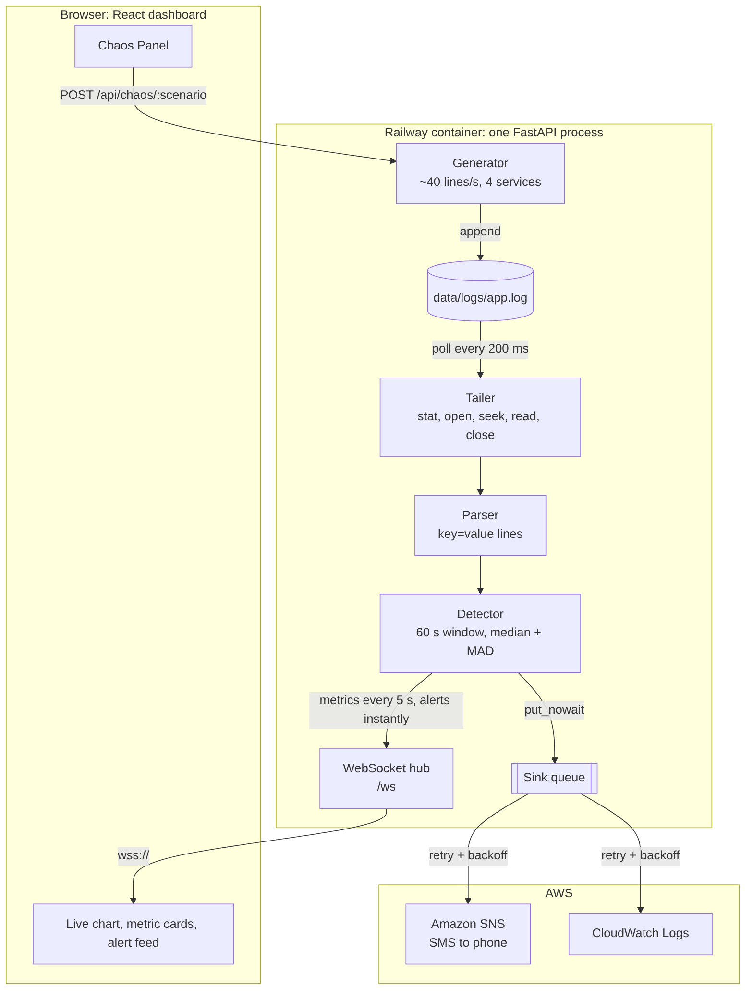
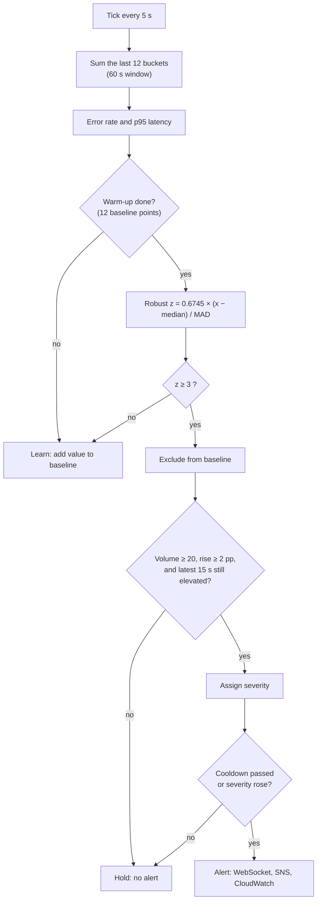
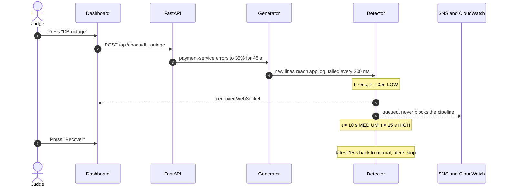

<table>
<tr>
<td width="60%" valign="top">

<h1>Sentinel</h1>

<b>Real-time log anomaly detection that explains itself.</b>

<p>
Sentinel tails a live, growing log file and learns what "normal" looks like for every service. It flags error-rate spikes, latency surges and services that go silent within seconds. Every alert shows its evidence: the current value, the learned baseline, a z-score and the log lines behind it. Alerts stream to a live dashboard over WebSockets and go out through AWS SNS and CloudWatch Logs.
</p>

<p>
<b>Team Aurora</b><br/>


</p>

</td>
<td width="40%" valign="top" align="right">

<b>Tech stack</b><br/><br/>


<br/>


<br/>


<br/>

<br/>


</td>
</tr>
</table>

<p align="center">
<a href="#-why-sentinel-stands-out">Why it stands out</a> ·
<a href="#-system-design">System design</a> ·
<a href="#-how-detection-works">How detection works</a> ·
<a href="#-90-second-demo">Demo</a> ·
<a href="#-quick-start">Quick start</a> ·
<a href="#-deploy-to-railway">Deploy</a>
</p>

---

## ✨ Why Sentinel stands out

Most log alerting relies on hand-tuned static thresholds: *page me if errors pass 5%*. Those are wrong for every service and every hour of the day. Sentinel learns the baseline for each service and alerts on **statistically meaningful change**, and every alert shows its evidence.

| | What it does | Why it matters |
|---|---|---|
| 🎛️ **Live Chaos Panel** | Press a button to inject a DB outage, a latency spike or a silent service into live traffic | Judges can watch detection happen instead of taking our word for it |
| 🔍 **Explainable alerts** | Every alert carries the current value, baseline median, MAD, z-score and 3 real log lines | You can see *why* it fired, not just that something is wrong |
| 📐 **Robust statistics, no black box** | Rolling median + MAD with a robust z-score | One outlier can't skew the baseline, and the maths fits on one slide |
| 🛡️ **Baseline that can't be poisoned** | Anomalous values are never learned | A long incident doesn't become the new normal |
| 🔕 **No alert storms** | Volume and absolute-rise guards, plus a 30 s cooldown per (service, detector) that still lets escalations through | "1 error in 3 lines = 33%" never pages anyone, and severity climbs LOW → MEDIUM → HIGH once |
| ⚡ **Fast in, fast out** | Detects on a 60 s window and clears on the latest 15 s | Alerts fire within ~5 s and stop within ~15 s of recovery |
| 🤫 **Silence detection** | Flags a service that stops logging | A service that stops logging produces no errors, so rate checks miss it. This detector doesn't |
| 🧱 **Never blocks** | File I/O and AWS calls run off the event loop, and sinks drain a queue with retry and backoff | A slow AWS call or a dead browser tab can't stall detection |
| 📱 **SMS-ready** | SNS messages fit in one SMS, e.g. `Sentinel HIGH: payment-service error rate 11.4% vs 2.7% z=11.8` | The phone alert is readable at a glance |
| 🚀 **One-click cloud deploy** | A single Docker image serves the API, WebSocket and dashboard from one origin | Push to GitHub, deploy on Railway, done |

### Measured on a live run

| Scenario | First alert | Peak severity | After recovery |
|---|---|---|---|
| DB outage (payment errors → 35%) | **LOW at ~5 s** (z = 3.5) | **HIGH at ~15 s** (z = 11.8) | quiet within ~15 s |
| Latency spike (gateway p95 → ~2 s) | **HIGH at ~5 s** (p95 1323 ms vs 190 ms) | HIGH | quiet within ~15 s |
| Silence (inventory stops logging) | **CRITICAL at ~17 s** | CRITICAL | clears when logs resume |
| Normal traffic, ~40 lines/s | **0 false alerts** | — | — |

---

## 🏗️ System design

The generator writes to a **real file** and the detector reads that **real file**. Nothing takes a shortcut from generator to detector, so the pipeline behaves the same way it would on a production log.



### Design decisions

- **Single process, single origin.** FastAPI serves `/api`, `/ws` and the built dashboard, so there's no CORS setup and WebSockets upgrade to `wss://` automatically behind Railway's TLS.
- **The tailer holds no file handle.** Every 200 ms it runs *stat → open → seek → read → close*. That makes log rotation safe on Windows and Linux alike: a changed `st_ino` means the file was rotated, and a smaller size means it was truncated. Both restart from offset 0. A partial last line is buffered until its newline arrives.
- **Everything slow is off the event loop.** File reads and `boto3` calls go through `asyncio.to_thread`, and the WebSocket hub drops any client that takes more than 1 s to accept a message.
- **The pipeline never waits on outputs.** Alerts are handed to the sink queue with `put_nowait`. A worker delivers them with 3 retries and exponential backoff.
- **Safe by default.** `DRY_RUN=true` logs the exact SNS and CloudWatch payloads instead of sending. Missing AWS credentials fall back to dry-run and never crash startup.

---

## 📐 How detection works

Each service (plus an aggregate `all` series) keeps **5 s buckets** keyed on event time. Every 5 s, Sentinel sums the last 12 buckets into a **60 s sliding window** and computes the error rate and p95 latency.



**Why median + MAD?** The mean and standard deviation get dragged around by the very spikes we want to catch. The median and the median absolute deviation don't, so one bad minute can't move the baseline. The factor `0.6745` rescales MAD so the z-score reads like a standard z-score. A small `MAD_FLOOR` stops a very stable stream from turning a tiny wobble into a huge z.

| Severity | Rule |
|---|---|
| 🔵 **LOW** | z ≥ 3 |
| 🟠 **MEDIUM** | z ≥ 5 |
| 🔴 **HIGH** | z ≥ 8 |
| 🩷 **CRITICAL** | error rate ≥ 50%, or a service silent for ≥ 15 s |

### Anatomy of an alert

```json
{
  "severity": "HIGH",
  "service": "payment-service",
  "detector": "error_rate",
  "current": 0.114,
  "baseline_median": 0.027,
  "baseline_mad": 0.005,
  "z": 11.75,
  "window_seconds": 60,
  "sample_lines": [
    "2026-09-28T10:35:30.412Z level=ERROR service=payment-service latency_ms=5037 msg=\"DB connection timeout after 5000ms host=db-2\""
  ],
  "message": "payment-service error rate 11.4% vs baseline 2.7% (z=11.8)"
}
```

---

## 🎬 90-second demo



1. **Open the dashboard.** The pill reads *Learning baseline* for ~60 s, then *All systems normal*. Point at the shaded band: that's the learned normal range.
2. **Press DB outage.** Within ~5 s the error-rate line breaks out of the band, an anomaly dot appears and a LOW alert slides in. It escalates to MEDIUM, then HIGH. Switch the chart to **Payments** and read the alert aloud: value vs baseline, z-score, and the actual `DB connection timeout` log lines.
3. **Press Silence.** About 15 s later a CRITICAL alert says inventory-service has written no logs.
4. **Press Recover.** Alerts stop within ~15 s and the pill returns to *All systems normal*.
5. **Show the phone** (with SNS configured) or the `[dry-run] SNS publish ...` lines in the backend log.

| Chaos button | Effect | Duration | What fires |
|---|---|---|---|
| **DB outage** | payment-service errors → ~35% with DB timeouts | 45 s | error rate, LOW → MEDIUM → HIGH |
| **Latency spike** | api-gateway p95 → ~2 s | 45 s | latency, HIGH |
| **Silence** | inventory-service stops logging | 30 s | silence, CRITICAL |
| **Recover** | ends every scenario | instant | — |

---

## 🚀 Quick start

Requires **Python 3.11+** and **Node 20+**. Use two terminals.

```bash
# backend: http://127.0.0.1:8000
cd backend
python -m venv .venv
source .venv/bin/activate            # Windows: .venv\Scripts\Activate.ps1
pip install -r requirements-dev.txt  # runtime deps + pytest, moto, ruff
uvicorn app.main:app --port 8000
```

```bash
# frontend: http://localhost:5173 (proxies /api and /ws to :8000)
cd frontend
npm install
npm run dev
```

Open **http://localhost:5173**, wait for *Learning baseline* to clear, then press a Chaos Panel button.

### Tests and quality checks

```bash
cd backend && pytest -q                       # 16 tests
cd frontend && npm run build && npm run lint
```

The tests cover the tailer (appends, partial lines, truncation, rotation), the parser (valid and garbage lines), warm-up silence, spike severity and escalation, low-volume noise, baseline poisoning, latency, silence, fast recovery, and the WebSocket snapshot.

---

## ☁️ Deploy to Railway

The repo deploys as **one service**. The [Dockerfile](Dockerfile) builds the React app in a Node stage, and a slim Python 3.11 stage serves it with FastAPI alongside `/api` and `/ws` on Railway's `$PORT`. [railway.json](railway.json) configures the Dockerfile builder, a `/api/health` healthcheck, restart on failure and **1 replica**, because detector state lives in process memory.

1. Push the repo to GitHub.
2. In Railway, choose **New Project → Deploy from GitHub repo** and pick this repo.
3. Under **Settings → Networking**, click **Generate Domain**.
4. *(Optional, for real alerts)* add these under **Variables**:

| Variable | Value |
|---|---|
| `DRY_RUN` | `false` |
| `AWS_ACCESS_KEY_ID`, `AWS_SECRET_ACCESS_KEY` | IAM user allowed `sns:Publish`, `logs:CreateLogGroup`, `logs:CreateLogStream`, `logs:PutLogEvents` |
| `AWS_REGION` | e.g. `ap-south-1` |
| `SNS_TOPIC_ARN` | your topic; subscribe your phone number for SMS |

**CLI alternative:** `npm i -g @railway/cli && railway login && railway init && railway up`

**Local image:** `docker build -t sentinel . && docker run -p 8000:8000 sentinel`, then open http://localhost:8000

---

## ⚙️ Configuration

Every threshold lives in [`backend/app/config.py`](backend/app/config.py) and can be overridden with an environment variable or a `.env` file. See [`.env.example`](.env.example).

| Variable | Default | Meaning |
|---|---|---|
| `BUCKET_SECONDS` / `WINDOW_SECONDS` | `5` / `60` | bucket size and sliding-window length |
| `BASELINE_POINTS` / `WARMUP_POINTS` | `60` / `12` | baseline history (~5 min) and warm-up length (~60 s) |
| `Z_LOW` / `Z_MEDIUM` / `Z_HIGH` | `3` / `5` / `8` | severity thresholds |
| `CRITICAL_ERROR_RATE` | `0.5` | error rate that is always CRITICAL |
| `MIN_VOLUME` / `MIN_ABS_DELTA` | `20` / `0.02` | noise guards: minimum lines in the window, minimum rise |
| `MAD_FLOOR` | `0.005` | stops a very stable stream from producing huge z-scores |
| `SILENCE_SECONDS` | `15` | gap that counts as a silent service |
| `RECENT_BUCKETS` | `3` | latest buckets that must still be elevated for an alert to fire |
| `GENERATOR_RATE` | `40` | synthetic lines per second |
| `LOG_MAX_BYTES` | `50000000` | generator truncates the log past this size |
| `DRY_RUN` | `true` | log sink payloads instead of sending them |

---

## 🔌 API

| Method | Path | Purpose |
|---|---|---|
| `GET` | `/api/health` | status, warm-up state, lines/sec, sink modes |
| `GET` | `/api/snapshot` | latest metrics, chart history, recent alerts |
| `GET` | `/api/alerts?limit=50` | recent alerts |
| `POST` | `/api/chaos/{db_outage \| latency_spike \| silence \| recover}` | start a scenario |
| `WS` | `/ws` | `snapshot` on connect, then `metrics` every 5 s, plus `alert`, `chaos` and `ping` |

Every WebSocket message uses the same envelope: `{ "type": "...", "data": { ... } }`.

---

## 🗂️ Project structure

```
├── Dockerfile · railway.json · .env.example
├── backend/
│   ├── app/
│   │   ├── main.py          # FastAPI app, lifespan, serves the built dashboard
│   │   ├── config.py        # every tunable (pydantic-settings)
│   │   ├── pipeline.py      # wires generator → file → tailer → detector → outputs
│   │   ├── generator.py     # synthetic traffic + chaos scenarios
│   │   ├── tailer.py        # rotation- and truncation-safe file follower
│   │   ├── parser.py        # key=value log parser, never raises
│   │   ├── detector.py      # sliding window, median + MAD baselines, detectors, severity
│   │   ├── sinks.py         # queue worker → console, SNS, CloudWatch
│   │   ├── models.py        # Alert model
│   │   └── api/             # REST routes + WebSocket hub
│   └── tests/               # pytest suite
└── frontend/src/
    ├── components/          # NavBar, MetricCard, LiveChart, AlertFeed, ChaosPanel
    ├── store/useSentinel.ts # zustand store fed by the WebSocket
    ├── lib/ws.ts            # reconnecting WebSocket with backoff
    └── types.ts             # mirrors the backend payloads
```

---

## 🧭 Roadmap

- **Incidents:** group related alerts into one incident with auto-resolve and correlation across services
- **Plain-English summaries:** an LLM narrator that only restates the measured numbers, with a deterministic template fallback
- **Never-seen-before errors:** log-template mining (Drain3) to flag brand-new error signatures
- **Benchmarking:** replay the labeled Loghub HDFS dataset and report precision, recall and F1

---

<p align="center">
Built with care by <b>Team Aurora</b><br/><br/>


</p>
